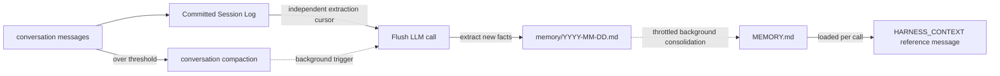

## Role

Lets the agent "remember facts across sessions" while keeping the conversation context bounded. Harness splits memory into two layers:

- **Layer 1 · daily log** `memory/YYYY-MM-DD.md` — appends extracted facts with exact duplicate bullet suppression;
- **Layer 2 · curated long-term** `MEMORY.md` — periodically merged + deduped by the LLM; loaded once per Agent call and supplied as HARNESS_CONTEXT reference material, not System.

Three companion mechanisms:

- **Conversation compaction** — summarizes history and keeps a recent tail when context is too long;
- **Overflow safety net** — when the model actually errors, force a compaction and retry;
- **Large tool-result offloading** — offload to disk + placeholder when a single tool returns too much.

## The three LLM calls at a glance

The memory pipeline runs **three independent LLM calls**, each with its own prompt and triggering rules. This is the easiest place to get confused when customizing:

| # | Operation | Writes to | Default prompt | Customize via |
|---|------|----------|---------------|----------|
| 1 | **Flush** — extracts long-term facts from a conversation window | `memory/YYYY-MM-DD.md` (append) | `MemoryFlushManager.DEFAULT_FLUSH_PROMPT` | `MemoryConfig.builder().flushPrompt(...)` |
| 2 | **Consolidation** — merges daily ledgers into `MEMORY.md` | `MEMORY.md` (full rewrite) | `MemoryConsolidator.DEFAULT_CONSOLIDATION_PROMPT` | `MemoryConfig.builder().consolidationPrompt(...)` |
| 3 | **Compaction summary** — distills the conversation prefix into one summary message | Injected into the current context | `CompactionConfig.DEFAULT_SUMMARY_PROMPT` | `CompactionConfig.builder().summaryPrompt(...)` |

The first two are "long-term memory settling" and live on `MemoryConfig`; the third is "in-context compression" and lives on `CompactionConfig`. All three LLM calls share the agent's primary model by default, but `MemoryConfig` and `CompactionConfig` each support a `.model(...)` override so you can use a lighter model for these auxiliary operations.

## How the two layers work



Key points:

- Flush only appends to Layer 1 and suppresses matching Markdown bullets after normalizing whitespace; Layer 2 is periodically rewritten as a whole. Flush does not rewrite `MEMORY.md`.
- Layer 2 is the only one injected into the prompt; Layer 1 waits to be merged.
- Native Session Log already records messages and execution facts. Compaction changes working context only; `session_history` / `session_search` read full history without duplicate offloading.

## When flush fires

Flush (path 1) is triggered at three different moments:

1. **End of every `call()`** — the default `MemoryFlushMiddleware` behaviour. Can be retuned to `NEVER` or `THROTTLED(Duration)` via `flushTrigger`.
2. **Compaction** — `CompactionConfig.flushBeforeCompact = true` (default) schedules background log extraction once the original messages are committed. Legacy execution attempts a synchronous, best-effort prefix flush.
3. **Overflow safety net** — when the model actually returns `context_length_exceeded`, the framework runs an emergency compaction that includes a flush.

All three paths share the extraction model, prompt, `flushContextPolicy`, `flushOptions` and optional `admission` in `MemoryConfig`; `CompactionConfig.model` separately controls summaries.

With native history, both triggers run extraction in the background. Compaction waits for its original-message log snapshot, not for extraction; required log commit failures still stop execution. Compaction triggers bypass the per-call throttle, including `NEVER`.

## Incremental extraction and recovery

Native extraction scans a stable prefix in pages of at most 256 events. Sources are messages, migration baselines and pre-compaction originals, excluding summaries. After delivery or durable failure-range isolation, workspace page progress commits and page receipts are reclaimed before advancing `agentscope.memory-flush.v1`. Workspace progress controls consumption; the backend cursor is a mirror. Each source traversal makes at most one compatibility prefix scan for legacy snapshots, shared across pages. Recreated instances and deferred-range retries may still need a prefix scan.

Native state uses `memory/.flush-state/<source-hash>.source.json`, with a source identity covering user, agent and session. Built-in logs expose stable `sourceId()` values; framework callers pass the full session key for custom backends, and low-level callers can pass an explicit source ID. Missing identity fails closed. Pending writes and failures in old `.json`/`.log.json` files still recover, but unscoped progress is not adopted: upgrading may replay previously extracted history. Recreated agents must preserve the workspace, logs, identity and stable message IDs; changing content under a reused ID does not create a new source.

| Input/output | Limit per model call (UTF-16 code units) |
| --- | --- |
| New conversation | 24,000; long messages are split across batches |
| Read-only preceding context | One previously consumed part, at most 8,000, when present and within budget |
| Existing memory | Complete entries alternating from both ends of `MEMORY.md` in original order, and from the end of today's ledger; at most 8,000 each |
| Output | 16,000; exactly `NO_REPLY` consumes the batch without an entry |
| Existing tool previews | Serialized arguments: 500; each text result: 1,000 |

Selection and final validation share `ContextPolicy` and count the complete request, including custom prompts. For a known window `W`, defaults reserve `min(4096, max(1, W/8))` output tokens and `max(1, W/50)` safety tokens. Unknown windows use a 64,000 input limit and 4,096 output reserve. `maxInputTokens` lowers the input limit; larger generation limits raise the reserve. Output limits use `flushOptions` first, then the model's positive limit and parameter type exposed by `getDefaultGenerateOptions()`. Otherwise, the reserve becomes a `maxTokens` cap; nonpositive values denoting unbounded output are not inherited. For a known window, inherited caps are limited to half the window in the actual request. Explicit caps are preserved and fail if reservations exhaust the input budget. Custom models and wrappers must expose or forward this method, or set `flushOptions` explicitly.

Character limits are secondary guards. Messages are split to fit the request budget, and unconsumed ranges resume from their source offsets. Existing entries are not split. A template that cannot fit fails before the model call without consuming the source.

Flush persists output, appends it to `memory/YYYY-MM-DD.md`, then confirms its receipts. Recovery replays prepared output without another model call; batch markers prevent redelivery, and whitespace-normalized bullet matching suppresses exact duplicates. Empty, truncated, `incomplete`/`content_filter` or tool-call output and model/storage errors leave the affected batch unconfirmed. A missing memory file is empty; an unreadable file fails the batch. Completed batches stay consumed. `NO_REPLY`, admission rejection and exact duplication emit distinct INFO outcomes.

Each model attempt first persists its source reference: native mode stores event ranges and message offsets, reading the same log on retry; legacy context mode retains source text. Cancellation or exit leaves a lease lasting `flushTimeout` plus the current backoff. Extraction or admission failures record a cooldown before reporting an error; later calls can process other sources. Each trigger retries at most one batch, selecting the earliest due across current and upgrade queues, with delays from 60 seconds to 30 minutes. Each state file retains at most 64 failed batches: a full queue or isolation write failure retains the source cursor. JEV errors do not bypass admission and failed facts are not discarded. Delivery and receipt failures still replay prepared output.

After configuration repair, subscribe to `agent.retryDeferredMemory(context)` to make failures eligible immediately, using normal recovery identity, switches and configuration. The low-level `MemoryFlushManager.retryDeferredMemories(...)` methods remain available. This overrides attempt leases, so stop related executions first; a concurrent state change reports an error and the caller can retry.

`flushTimeout` defaults to two minutes for the whole flush, including manager scheduling, all extraction batches and candidate judgments, excluding middleware queue wait. Timeout cancels upstream and releases the namespace queue; completed batches remain committed and unfinished sources retry on a later trigger. Custom code must honor cancellation or interruption to release its own resources.

Extraction failures do not prevent native compaction: a later trigger replays the original log events. Without native history, extraction reads only the current context; best-effort pre-compaction failure can leave removed source unavailable if it was not durably isolated.

Replicas share storage and namespace; conditional commits prevent concurrent writers from overwriting each other's changes. Native CAS is not required: local files use OS locks and atomic rename, while remote files reuse conditional store updates. Backends that reuse versions after deletion must atomically match both version and value. A durable single-writer queue could serialize ordinary writes instead; this implementation has no such mode. Model calls may repeat, but one prepared result commits. Routing, overlay copy-on-write and host-side sandbox persistence remain in effect; receipts never inherit from a shared overlay layer. Custom backends implement `atomicTextFile(context, path, inheritLower)` using equivalent conditional-write semantics; extraction, consolidation and `memory_save` require it.

Native log receipts are reclaimed per page. Legacy context mode retains historical receipts. Preserve original events until their deferred ranges finish consumption; a durable range is not a copy of the source. A cursor beyond the log head fails closed rather than resetting. Stop related executions and recovery tasks, back up logs, extraction state and memory, then verify session identity and restore the matching complete log. If restoration is impossible, reconcile before migrating to a new session identity and replaying. Deleting only `.source.json` neither resets the backend cursor nor preserves deferred ranges. Internal memory state is excluded from the workspace path index. External overwrites bypass conditional commits; network-filesystem and power-loss behavior remain unverified. Semantic updates and total storage capacity are not managed here.

### Catch-up without another request

The host can schedule `agent.recoverMemory(context)` for a known native session. Subscribe to the returned `Mono`: it catches up extraction, then runs the existing throttled maintenance, without an agent turn, tool execution or sandbox startup. It reuses the agent's memory model, budgets, admission, storage and durable progress. Maintenance also runs after extraction errors; its recovery deadline equals `flushTimeout`. `disableMemoryHooks()` disables this entry; `NEVER` skips extraction but still allows maintenance. Recovery bypasses the per-call `THROTTLED` gap.

The maintenance gate includes the normalized workspace root and isolation identity, so separate workspaces for one user each progress. Replicas using different host paths may claim separate maintenance windows; conditional commits still guard shared-file writes.

Discovery and scheduling belong to the host lifecycle, outside rebuilt request agents. Use a durable session catalogue or scoped `SessionLogStore.list(context)` where supported; a scope-local list cannot discover other users or inaccessible namespaces. Agent recreation preserves progress through the same files and log cursor. No source backlog means no extraction call; no ledger backlog means no consolidation call.

Service provides an [opt-in recovery worker](/v2/en/service/operations#dormant-session-memory). Without host scheduling, recovery still needs another request or compaction trigger. All replicas stopped, missing source logs and permanent model/storage failures cannot complete catch-up.

### Optional admission

`MemoryAdmission` is optional and replaceable. It reviews each extracted bullet against the new source batch, selected existing entries and earlier accepted candidates. Prefaces and headings before bullets are ignored; continuation lines are preserved. Output without any bullet leaves the source retryable. Clear rejection consumes the source; errors, empty decisions and uncertainty fail the batch. Owner is the user ID, falling back to the receipt scope hash for anonymous callers. Recovery uses prepared output without rejudging; decisions are not an audit log.

The JEV extension supplies an adapter:

```java
MemoryConfig.builder()
    .admission(new JevMemoryGate(judge).admission())
    .build();
```

Admission is off by default. The JEV adapter requires source-supported durable value; conflicts need explicit evidence of a correction or an already effective change for the same subject and scope. A newer statement, quote or unconfirmed proposal alone does not establish a change. Accepted corrections enter the daily ledger; later consolidation updates MEMORY, so old and new facts may coexist. Expected probability ≥0.8 passes, ≤0.2 fails, and intermediate values are inconclusive; these thresholds are not calibrated on project conversations.

`JevMemoryGate.assess()` retains its original policy for direct callers; `admission()` adapts JEV to Harness. Applications can supply their own `MemoryAdmission` instead. Changing policies does not replay consumed sources.

Existing entries are budget-limited and may become stale across sessions, so admission cannot ensure global conflict freedom. It adds judge calls, does not skip extraction, and does not intercept `memory_save` or consolidation.

<span id="enable-compaction" />

## Tune context compaction

Harness enables context compaction by default. The following configuration adjusts its triggers and retention policy. See [Context management](/v2/en/docs/harness/context) for how compaction fits into each model request.

```java
HarnessAgent agent = HarnessAgent.builder()
    .name("MyAgent")
    .model(model)
    .workspace(workspace)
    .compaction(CompactionConfig.builder()
        .triggerMessages(30)     // fire at 30 messages
        .keepTokens(0)           // retain the tail by message count
        .keepMessages(10)        // keep the last 10 after compaction
        .build())
    .build();
```

Common options:

| Field | Default | Meaning |
|-------|---------|---------|
| `triggerMessages` | `50` | Trigger by message count (`0` = off) |
| `triggerTokens` | `0` | Trigger by estimated tokens; `0` = dynamic, based on the budget left for conversation history in the final model request |
| `keepMessages` | `20` | Number of tail messages to keep |
| `keepTokens` | `-1` | `-1` = dynamic (based on the remaining conversation budget in the final model request); `0` = use `keepMessages`; `>0` = fixed token budget, overriding `keepMessages` |
| `flushBeforeCompact` | `true` | Trigger background log extraction during compaction; synchronous best-effort flush in legacy execution |
| `summaryPrompt` | see `DEFAULT_SUMMARY_PROMPT` | Path-3 summary prompt (must contain `{messages}`) |
| `model` | `null` (uses the agent's primary model) | Dedicated model for the compaction summarization call |

**Auto-recovery on overflow**: when the model returns `context_length_exceeded` or a similar error, the framework attempts forced compaction unless compaction is disabled. In the default `EVENT_LOG` execution mode, it retries the current reasoning step once within the same execution. No explicit `.compaction(...)` call is needed to enable this; a repeated overflow propagates to the caller.

### Want it lighter? Trim arguments first

Tool calls like `write_file` carry huge arguments that nobody reads later. Before LLM summarization you can run a **non-LLM** string truncation:

```java
CompactionConfig.builder()
    .triggerMessages(80)
    .truncateArgs(CompactionConfig.TruncateArgsConfig.builder()
        .maxArgLength(2000)
        .truncationText("... [truncated] ...")
        .build())
    .build();
```

## Customizing the memory pipeline: `MemoryConfig`

`MemoryConfig` is the single place to configure flush / consolidation prompts, throttling, retention, and the per-call flush trigger. Every field has a default. Incremental receipts and extraction character limits apply with the default configuration too.

Per-call flush and background consolidation have independent throttle windows. In both cases, the first eligible `call()` runs the work immediately; a minimum gap limits only subsequent runs and is not an initial delay.

### Example 1: throttle per-call flush to save tokens

A flush LLM call after every agent invocation can add up on long sessions. Throttle it to at most once every 10 minutes:

```java
HarnessAgent.builder()
    ...
    .memory(MemoryConfig.builder()
        .flushTrigger(MemoryConfig.FlushTrigger.throttled(Duration.ofMinutes(10)))
        .build())
    .build();
```

Notes:

- `THROTTLED` only affects the per-call trigger. Compaction and overflow recovery trigger extraction independently when `flushBeforeCompact` is enabled.
- The first eligible call flushes immediately; `Duration.ofMinutes(10)` limits only later per-call flushes.
- **Native history is unaffected**: flush throttling does not disable Session Log, history search or checkpoint recovery.

### Example 2: disable per-call flush entirely

```java
.memory(MemoryConfig.builder()
    .flushTrigger(MemoryConfig.FlushTrigger.never())
    .build())
```

Now only compaction triggers flush when `flushBeforeCompact` is enabled; extraction still has its own model cost.

> To turn off flush **and** background maintenance use `.disableMemoryHooks()`; `flushTrigger(NEVER)` only stops the per-call flush — background consolidation still runs.

### Example 3: extend the default prompt with project rules

```java
.memory(MemoryConfig.builder()
    .flushPrompt(MemoryFlushManager.DEFAULT_FLUSH_PROMPT + """

        Additional project rules:
        - Never record customer PII (names, emails, phone numbers).
        - Always use English for project-internal vocabulary.
        """)
    .build())
```

### Example 4: fully custom consolidation prompt

```java
.memory(MemoryConfig.builder()
    .consolidationPrompt("""
        You are merging daily memory ledgers into MEMORY.md.
        Keep within %d tokens (~%d chars). Output the complete file in markdown.
        ... your custom rules ...
        """)
    .build())
```

> **Important**: a custom consolidation prompt **must** contain exactly two `%d` placeholders (max-tokens then max-chars). The Builder rejects anything else at construction time so you don't hit a runtime `MissingFormatArgumentException`.

### Example 5: tune background maintenance

```java
.memory(MemoryConfig.builder()
    .consolidationMinGap(Duration.ofHours(2))   // first call may run; later runs at least 2h apart
    .dailyFileRetentionDays(30)                 // archive daily logs after 30 days
    .consolidationMaxTokens(8_000)              // 8K token target, 32K character body cap
    .build())
```

### Example 6: use a smaller model for memory operations

Flush and consolidation don't need the full power of the primary reasoning model — use a cheaper one to save cost:

```java
HarnessAgent.builder()
    .model("openai:o3")                   // primary reasoning model
    .memory(MemoryConfig.builder()
        .model("openai:gpt-4.1-mini")     // lighter model for memory ops
        .build())
    .compaction(CompactionConfig.builder()
        .model("openai:gpt-4.1-mini")     // lighter model for compaction
        .build())
    .build();
```

`model(String)` resolves via `ModelRegistry.resolve()`; you can also pass a `Model` instance. When not set, falls back to the agent's primary model.

### `MemoryConfig` field reference

| Field | Default | Purpose |
|------|------|------|
| `model` | `null` (uses the agent's primary model) | Dedicated model for flush / consolidation; accepts a `Model` instance or a `"provider:model"` string |
| `flushPrompt` | `null` (uses `DEFAULT_FLUSH_PROMPT`) | SYSTEM prompt for path 1 |
| `consolidationPrompt` | `null` (uses `DEFAULT_CONSOLIDATION_PROMPT`) | Template for path 2 (must contain two `%d`) |
| `consolidationMaxTokens` | `4_000` | Consolidation token target; four times this value caps the MEMORY body for consolidation and `memory_save` (UTF-16 code units) |
| `consolidationContextPolicy` | `ContextPolicy.defaults()` | Independent consolidation request budget; does not reuse the extraction policy |
| `consolidationMinGap` | `30 min` | Gap between background maintenance runs; the first eligible call runs immediately |
| `dailyFileRetentionDays` | `90` | Days before a daily log moves to `memory/archive/` |
| `flushTrigger` | `FlushTrigger.always()` | `ALWAYS` / `NEVER` / `THROTTLED(Duration)` |
| `flushContextPolicy` | `ContextPolicy.defaults()` | Whole-request estimation and final input validation for flush |
| `flushOptions` | `null` | Generation options; set only one positive `maxTokens` / `maxCompletionTokens`, using the parameter supported by the adapter; select the model through `model`, not these options |
| `flushTimeout` | `2 min` | Positive total deadline for extraction and admission, shared by all batches |
| `admission` | `null` | Optional candidate gate; backend failures must be errors, not rejections |

## Large tool-result offloading

Tool-result offloading works independently of conversation summarization and is enabled by default in Harness. While preparing model input, an oversized tool result in history is written to the workspace. The model receives a head/tail preview and a file path, which it can use with `read_file` to retrieve the full text as needed. The following shows the default configuration; see [Context management](/v2/en/docs/harness/context) for tuning and details:

```java
HarnessAgent.builder()
    ...
    .toolResultEviction(ToolResultEvictionConfig.defaults())
    .build();
```

Defaults:

- Triggered at 80K characters
- Keeps ~2K chars at head + tail + a line "full content at `{path}`"
- `read_file` is excluded by default (to avoid re-offloading what was just read back)

Customize threshold or destination via `ToolResultEvictionConfig.builder()...build()`.

## Tools the agent can use itself

When memory is enabled, the agent gets four tools:

- `memory_search query="..."` — keyword scan over `MEMORY.md` + `memory/*.md`
- `memory_get path="memory/2026-06-02.md" startLine=10 endLine=40` — read a specific line range
- `memory_save content="..."` — persist a memory via `MEMORY.md` and the daily ledger
- `session_search query="..."` — search past session transcripts

`memory_save` checks the MEMORY body cap during conditional writes (default 16,000, including newlines). Overflow or exhausted conflicts return a tool error without appending either file; conflict retries re-read available capacity. On overflow, save less content or retry after existing memory is reduced. Rejected content does not enter the ledger: without unmerged ledger entries, maintenance does not call the model to free space, and new entries do not guarantee a shorter consolidation output. MEMORY and the daily ledger remain separate writes: a ledger failure does not roll back the saved MEMORY. Semantic admission does not intercept this tool.

When the model sees a "MEMORY truncated" note in the prompt, it typically calls `memory_search` to look further back.

`memory_search` and `session_search` accept an optional `matchMode`:

| Mode | Behavior |
| --- | --- |
| `phrase` (default) | Match the entire query as a literal substring, preserving existing behavior |
| `all` | Split on whitespace; every keyword must occur in the same record, in any order |
| `any` | Split on whitespace; at least one keyword must occur in the record |

For example, `query="deploy blue" matchMode="all"` matches `deploy using the blue configuration`, while the default phrase mode does not.
A record is one line for Memory and one entry for Session; keywords are not combined across records.
Matching is case-insensitive and regex metacharacters are literal. There is no automatic Chinese word segmentation or date-expression parsing.
An omitted or `null` mode defaults to `phrase`; other values (including an empty string) return an error. Multi-keyword modes ignore extra whitespace and duplicate terms; whitespace-only queries never match all records.
Result formatting, ordering and limits are unchanged; `any` does not introduce relevance ranking. Existing Java method signatures remain available.

## Background maintenance

When memory is enabled, a throttled background job also runs. The first eligible `call()` runs it immediately; later calls observe the minimum gap (30 minutes by default):

- Attempts to archive daily logs older than `dailyFileRetentionDays` (default 90 days) to `memory/archive/`; with consolidation enabled, offsets and hashes must prove full consumption, so files covered only by a legacy watermark are retained
- Merges one budgeted ledger batch into `MEMORY.md`

Entering maintenance does not necessarily call the model: consolidation skips the LLM request when there are no new daily ledger entries since the last successful consolidation. `FlushTrigger.never()` does not disable this maintenance path.

Consolidation sends the full current `MEMORY.md` plus at most 24,000 characters of new ledger input, within the independent `consolidationContextPolicy` budget, using the same model output cap for selection and execution. Maintenance merges at most four batches, stopping when progress does not advance. Lines stay intact when possible; oversized lines split at code-point boundaries. If the current memory and prompt leave no room for new input, the call fails without advancing progress. The auxiliary call never triggers compaction.

File offsets and prefix hashes in `memory/.consolidation-progress.json` survive instance recreation and resume appended tails. A changed prefix replays the file; malformed progress stops the run. The legacy `.consolidation_state` watermark remains readable and supplies the initial migration cutoff, then offsets control input selection. Both state files belong to the writable namespace and never inherit from a shared overlay layer.

Each consolidation first removes completed archived offsets: archive content must fully match the offset and hash, and the original path must be absent. Cleanup also runs without new ledger input and needs no model call. Read failures or progress conflicts preserve state for later maintenance. It retains the migration cutoff, extraction receipts, logs and archive content; restoring an archived file to its original path may replay it.

Only complete, text-only, non-empty output within the body target commits through CAS against the input memory snapshot. Conflicts and invalid output do not consume the ledger batch. Batch offsets are CAS-written after memory, so a crash or progress-write failure can replay the committed batch.

Archival conditionally creates or reuses an identical copy, or advances a prefix copy to the confirmed snapshot using CAS, before `compareAndDelete` removes the source. A changed source, a non-prefix archive conflict, or an unsupported conditional delete retains the source; there is no fallback to ordinary `move`. Interruption after copying can leave both files, and an identical copy can be reused after restart. Appends during archival remain active for subsequent consolidation.

Local deletion shares the append OS lock. Remote backends use `BaseStore.putIfUnchanged` and `deleteIfUnchanged`; backends that reuse versions must atomically match version and value for both updates and deletes. Local files and `InMemoryStore` currently support conditional deletion; other built-in remote stores retain the source until implemented. Overlay files with a matching lower-layer path also retain the upper copy to avoid revealing a shared ledger after deletion.

## Turn it off entirely

If you want to handle memory yourself or wire your own tools:

```java
HarnessAgent.builder()
    ...
    .disableMemoryHooks()      // disables flush + background maintenance (+ auto-extract prompt line)
    .disableMemoryTools()      // skips memory_search / memory_get / memory_save / session_search
                               // and matching Memory Recall / tool Persistence guidance
    .build();
```

Together these also skip memory material in `HARNESS_CONTEXT` (`MEMORY.md`) injection while keeping Domain Knowledge / AGENTS / knowledge context.

`disableMemoryHooks()` is the nuclear option for background memory work; if you only want to throttle, use `.memory(MemoryConfig.builder().flushTrigger(...).build())` instead.

## Related Pages

- [Workspace](/v2/en/docs/harness/workspace) — where `MEMORY.md` / `memory/` live in the workspace
- [Session logs and recovery](/v2/en/docs/harness/session-log) — full history, checkpoints and search
- [Architecture](/v2/en/docs/harness/architecture) — how facts in long conversations settle into `MEMORY.md`

For message placement, refresh timing and final budgeting, see [Context management](/v2/en/docs/harness/context).

Legacy JSONL pruning and `sessionRetentionDays` have been removed. Native history has no automatic retention policy, and memory maintenance no longer deletes old archives.
