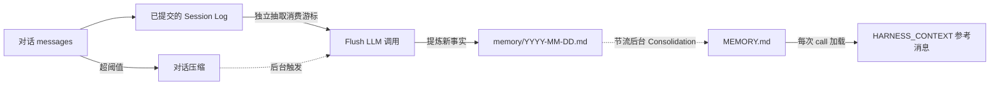

## 作用

让 agent "记住跨会话的事实"，同时避免对话上下文无限增长。Harness 把记忆拆成两层：

- **第一层·日流水账** `memory/YYYY-MM-DD.md` —— 追加抽取事实，抑制完全重复的条目；
- **第二层·策划后长期记忆** `MEMORY.md` —— 周期性 LLM 合并去重的产物；每次 Agent call 加载，在模型请求中作为参考资料进入 HARNESS_CONTEXT，而不是 System。

围绕这两层，还有三个常用机制：

- **对话压缩** —— 上下文太长时摘要历史、保留尾部；
- **上下文溢出兜底** —— 模型真的报错时强制压缩并重试；
- **大工具结果卸载** —— 单次工具返回过大时落盘 + 占位符。

## 三处 LLM 调用的全景

记忆管线里有 **三处独立的 LLM 调用**，每一处都有自己的 prompt 和触发时机。这是定制时最容易混淆的地方：

| # | 操作 | 写入目标 | Prompt 默认值 | 定制入口 |
|---|------|----------|---------------|----------|
| 1 | **Flush** —— 从对话窗口抽取长期事实 | `memory/YYYY-MM-DD.md`（追加） | `MemoryFlushManager.DEFAULT_FLUSH_PROMPT` | `MemoryConfig.builder().flushPrompt(...)` |
| 2 | **Consolidation** —— 把每日流水账合并到 `MEMORY.md` | `MEMORY.md`（整体重写） | `MemoryConsolidator.DEFAULT_CONSOLIDATION_PROMPT` | `MemoryConfig.builder().consolidationPrompt(...)` |
| 3 | **Compaction summary** —— 把对话前缀蒸馏成一条摘要消息 | 注入到当前上下文 | `CompactionConfig.DEFAULT_SUMMARY_PROMPT` | `CompactionConfig.builder().summaryPrompt(...)` |

前两个是"沉淀长期记忆"，由 `MemoryConfig` 管；第三个是"压缩当下上下文"，由 `CompactionConfig` 管。三处 LLM 调用默认共享 agent 主模型，但 `MemoryConfig` 和 `CompactionConfig` 各自支持 `.model(...)` 覆盖，允许用更轻量的模型执行这些辅助操作。

## 两层记忆是怎么工作的



要点：

- Flush 只向第一层追加，并在规范化空白后抑制相同 Markdown 条目；第二层周期性整体重写，Flush 不重写 `MEMORY.md`。
- 第二层永远是 LLM 注入提示的来源；第一层等待被合并。
- 原生 Session Log 已记录完整消息与执行事实；压缩只改变模型工作上下文，历史由 `session_history` / `session_search` 读取，不再重复落盘。

## Flush 的三个触发点

Flush（路径 1）会在以下三个时机被触发：

1. **每次 `call()` 结束** —— `MemoryFlushMiddleware` 的默认行为。可以用 `flushTrigger` 改成 `NEVER` 或 `THROTTLED(Duration)`。
2. **压缩触发** —— `CompactionConfig.flushBeforeCompact = true`（默认）时，原始消息提交日志后调度后台抽取；旧执行模式同步尝试抽取前缀，失败时尽力继续。
3. **上下文溢出兜底** —— 模型真的报 `context_length_exceeded` 时，框架做一次紧急压缩，连带 flush。

这三处共用 `MemoryConfig` 的抽取模型、prompt、`flushContextPolicy`、`flushOptions` 和可选 `admission`；摘要模型由 `CompactionConfig.model` 单独控制。

启用原生日志时，两类触发都在后台抽取。压缩等待原始消息快照提交日志，不等待抽取；关键日志提交失败仍会阻止执行。压缩触发不受每轮节流影响，包括 `NEVER`。

## 增量抽取与恢复

原生日志按稳定前缀扫描，每页最多 256 个事件。消息、迁移基线和压缩前原文是来源，摘要不参与抽取。输出完成或失败范围已持久保存后，先提交工作区页进度并回收本页回执，再推进 `agentscope.memory-flush.v1` 游标；工作区进度是消费依据，后端游标仅作镜像。新快照带来源引用；旧快照在一次来源遍历中至多补扫一次此前历史，跨页复用已见 ID。重建实例或重试失败范围仍可能补扫前缀。

原生日志状态在 `memory/.flush-state/<source-hash>.source.json`，来源身份包含用户、agent 和会话；内置日志提供稳定的 `sourceId()`，框架为自定义后端传入完整会话键，低层调用可显式传 `sourceId`。缺失身份时拒绝消费。旧 `.json`／`.log.json` 的待投递与失败批次继续恢复，但无来源水位不认领给新日志，因此升级可能重放已抽取历史。重建实例须保留工作区、日志、身份和稳定消息 ID；复用 ID 修改正文不视为新消息。

| 输入／输出 | 每次模型调用的限制（UTF-16 代码单元） |
| --- | --- |
| 新增对话 | 24,000；长消息分片、多批处理 |
| 只读前文 | 已消费的前一个片段，最多 8,000；原文仍在且预算容纳时加入 |
| 已有记忆 | `MEMORY.md` 交替从头尾选择并保持原顺序、当日日志从尾选完整条目，各最多 8,000 |
| 输出 | 16,000；精确返回 `NO_REPLY` 消费本批但不写条目 |
| 原有工具预览 | 序列化参数 500；每段文本结果 1,000 |

组批和最终校验共用 `ContextPolicy`，计算包含自定义 prompt 的完整请求。已知窗口 `W` 时，默认预留 `min(4096, max(1, W/8))` 输出 token 和 `max(1, W/50)` 安全余量；未知窗口使用 64,000 输入上限和 4,096 输出预留。`maxInputTokens` 可降低输入上限，较大的生成上限会提高预留。输出上限优先使用 `flushOptions`，其次继承模型通过 `getDefaultGenerateOptions()` 暴露的正值上限及参数类型；两处均未设置时才使用预留值作为 `maxTokens`，不继承表示无限输出的非正值。已知窗口时，继承上限最多为窗口的一半，并用于实际请求；显式上限不静默改写，预留耗尽输入预算则报错。自定义模型／包装器须暴露或转发该方法，否则需显式配置 `flushOptions`。

字符限制是第二道护栏。消息会按请求预算切分，未消费部分按源文本偏移续读。已有条目不拆分；模板本身超出预算时，调用前报错且不消费来源。

Flush 先持久化输出，再追加到 `memory/YYYY-MM-DD.md`，最后确认回执。恢复重放已准备输出，不重调模型；批次标记防止重复投递，规范化空白后按完整 bullet 精确去重。空响应、截断、`incomplete`／`content_filter`、工具调用及模型／存储错误不确认本批。文件缺失视为空，读取失败则报错；已完成批次保持已消费。`NO_REPLY`、准入全拒和精确重复分别记录 INFO 结果。

模型调用前先持久保存尝试：日志模式只存事件范围与消息片段偏移，重试从同一日志读取；旧上下文模式仍保存原文。取消或退出后的租约持续 `flushTimeout` 加本次退避，其他副本在租约内不重调模型。抽取或准入失败后记录冷却并报错；后续调用可继续处理其他来源。每次触发最多重试一批，按当前及升级遗留队列中的最早到期时间选择，间隔从 60 秒指数增长到 30 分钟；每个状态文件最多保留 64 个失败批次，队列满或隔离写入失败时保留源游标。JEV 错误不放行，失败事实不丢弃。投递与回执故障仍重放已准备输出。

修复配置后可订阅 `agent.retryDeferredMemory(context)` 提前重试，它沿用普通恢复的身份、开关和配置；低层调用仍可用 `MemoryFlushManager.retryDeferredMemories(...)`。此操作会提前结束尝试租约，应在相关执行停止后使用。Service worker 遵守退避，没有对外提供手动重试接口。

`flushTimeout` 默认为两分钟，覆盖 manager 调度、所有抽取批次和候选准入，不含 middleware 入队等待。超时会取消上游并释放命名空间队列；已完成批次保留，未完成来源等后续触发重试。自定义代码须响应取消或中断，才能释放自身资源。

抽取失败不阻止原生日志模式下的压缩；后续触发从日志补抽原文。未启用原生日志时，抽取只读取当前上下文，压缩前尽力抽取失败后，尚未持久隔离且已移出的原文可能无法重试。

副本共享存储和命名空间，通过条件提交防止并发写入互相覆盖。后端不必原生支持 CAS：本地使用 OS 锁和原子重命名，远端复用 store 的条件更新；删除后重建可能复用版本的后端须原子匹配版本和内容。持久单写入者队列也能串行化普通写入，但本实现没有这种模式。模型调用可能重复，只提交一份准备结果。路由、overlay 写时复制及 sandbox 宿主机持久化保持生效，回执不继承共享层。自定义后端以等价的条件写入语义实现 `atomicTextFile(context, path, inheritLower)`；抽取、合并和 `memory_save` 均需要此能力。

原生日志回执按页回收；旧上下文模式没有可靠序号，保留其历史回执。失败范围完成消费前必须保留对应原文日志，持久保存范围不等于备份原文。游标超过日志头部时拒绝运行，不自动清零。此时先停止相关执行和恢复任务，备份日志、抽取状态与记忆文件，核对会话身份并恢复匹配的完整日志；无法恢复时，需对账后迁移到新的会话身份再重放。仅删除 `.source.json` 不会重置后端游标，且会丢失失败范围。内部记忆状态不进入工作区路径索引。外部覆盖不参与条件提交；网络文件系统与断电行为未验证。此路径不管理语义更新和存储总容量。

### 无后续请求时补偿

宿主可定时为已知原生会话调用 `agent.recoverMemory(context)`。订阅返回的 `Mono` 后，先补抽，再运行现有的节流维护，不执行 agent 回合、工具或启动 sandbox；模型、预算、准入、存储和持久进度沿用该 agent 的配置。抽取报错后仍运行维护；补偿维护的超时等于 `flushTimeout`。`disableMemoryHooks()` 关闭此入口；`NEVER` 跳过抽取，但仍允许维护；补偿不受每轮 `THROTTLED` 间隔限制。

维护 gate 包含规范化工作区根路径与隔离身份，同一用户的不同工作区可分别推进；副本使用不同宿主路径时可能分别领取维护窗口，共享文件写入仍受条件提交保护。

发现与调度归宿主生命周期管理，放在每次请求重建的 agent 之外。来源使用持久会话目录，或后端支持的作用域内 `SessionLogStore.list(context)`；作用域内列表无法发现其他用户或不可访问的命名空间。重建 agent 后通过同一文件与日志游标续跑。没有来源积压时不调抽取模型，没有未合并流水账时不调用 consolidation 模型。

Service 提供[显式启用的补偿 worker](/v2/zh/service/operations#无人访问会话的记忆补偿)。未接宿主调度时，恢复仍依赖后续请求或压缩触发；所有副本停机、原文日志丢失或模型／存储永久失败时，无法补齐。

### 可选写入准入

`MemoryAdmission` 可选且可替换，逐条评审抽取出的 bullet，依据本批新增原文、选中的旧条目及本批先前通过的候选。忽略 bullet 前的说明和标题，保留条目续行；没有任何 bullet 时保留来源重试。明确拒绝会消费来源；错误、空决策或不确定会使本批失败。owner 优先使用用户 ID，匿名调用使用回执作用域哈希。恢复使用已准备输出，不重判；裁决不作为审计日志。

JEV 扩展提供适配器：

```java
MemoryConfig.builder()
    .admission(new JevMemoryGate(judge).admission())
    .build();
```

准入默认关闭。JEV 适配器要求来源支持且有持久价值；冲突须有来源明确支持对同一对象、同一范围的纠正或已生效变更。更晚出现的陈述本身、引用或未确认提议不构成变更依据。通过的纠正进入日流水账，后续 consolidation 才更新 MEMORY，期间新旧事实可能共存。期望概率 ≥0.8 通过，≤0.2 失败，中间值不确定，阈值未做项目对话校准。

`JevMemoryGate.assess()` 保留原有政策，供业务直接调用；`admission()` 将 JEV 接入 Harness。应用也可注入自己的 `MemoryAdmission`。切换政策不重放已消费来源。

旧条目受预算限制，也可能因跨会话更新而过期，因此不能保证全局无冲突。准入增加 judge 调用，不跳过抽取，不拦截 `memory_save` 或 consolidation。

<span id="开启压缩" />

## 调整上下文压缩

Harness 默认启用上下文压缩，下面的配置用于调整触发和保留策略。它如何参与每次模型请求的构建，见[上下文管理](/v2/zh/docs/harness/context)。

```java
HarnessAgent agent = HarnessAgent.builder()
    .name("MyAgent")
    .model(model)
    .workspace(workspace)
    .compaction(CompactionConfig.builder()
        .triggerMessages(30)     // 消息条数到 30 触发
        .keepTokens(0)           // 按消息条数保留尾部
        .keepMessages(10)        // 压缩后保留最近 10 条
        .build())
    .build();
```

常用配置项：

| 参数 | 默认 | 含义 |
|------|------|------|
| `triggerMessages` | `50` | 按条数触发（`0` 表示关闭） |
| `triggerTokens` | `0` | 按 token 估算触发（`0` 表示动态计算，依据最终模型请求为对话历史留下的预算） |
| `keepMessages` | `20` | 保留尾部条数 |
| `keepTokens` | `-1` | `-1` 表示动态计算（基于最终模型请求的对话剩余预算）；`0` 表示使用 `keepMessages`；`>0` 表示固定 token 预算并覆盖 `keepMessages` |
| `flushBeforeCompact` | `true` | 压缩时触发后台日志抽取；旧执行模式同步尽力抽取 |
| `summaryPrompt` | 见 `DEFAULT_SUMMARY_PROMPT` | 路径 3 的摘要 prompt（必须含 `{messages}` 占位符） |
| `model` | `null`（使用 agent 主模型） | 压缩摘要使用的独立模型 |

**上下文溢出自动恢复**：模型返回 `context_length_exceeded` 等错误时，只要没有禁用压缩，框架就会尝试强制压缩。默认的 `EVENT_LOG` 执行模式会在本次执行内重试当前推理一次，无需手工调用 `.compaction(...)` 开启；如果仍然溢出，错误会返回调用方。

### 想再轻一些？预处理参数截断

`write_file` 这种工具调用，参数体量很大但后期没人再看。在 LLM 摘要之前，可以先做一个**不走 LLM** 的字符串截断：

```java
CompactionConfig.builder()
    .triggerMessages(80)
    .truncateArgs(CompactionConfig.TruncateArgsConfig.builder()
        .maxArgLength(2000)
        .truncationText("... [truncated] ...")
        .build())
    .build();
```

## 定制 Memory pipeline：`MemoryConfig`

`MemoryConfig` 集中管理 flush / consolidation 两条路径的 prompt、节流、保留时长，以及 per-call flush 的触发策略。所有字段都有默认值；默认配置同样启用增量回执和抽取字符限制。

Per-call flush 与后台 consolidation 使用两套独立的节流窗口。两者第一次符合条件的 `call()` 都会立即放行；最小间隔只限制后续运行，不表示首次运行前需要等待。

### 例 1：节流 per-call flush，省 token

每次 agent 调用结束都做一次 flush LLM 调用，对长会话来说成本不低。把它节流到「最多每 10 分钟一次」：

```java
HarnessAgent.builder()
    ...
    .memory(MemoryConfig.builder()
        .flushTrigger(MemoryConfig.FlushTrigger.throttled(Duration.ofMinutes(10)))
        .build())
    .build();
```

注意：

- `THROTTLED` 只影响每轮触发；启用 `flushBeforeCompact` 时，压缩和溢出恢复仍独立触发抽取。
- 第一次符合条件的 call 会立即 flush；`Duration.ofMinutes(10)` 只限制后续的 per-call flush。
- **原生日志不受影响**：Flush 节流不会停用 Session Log、历史检索或 checkpoint 恢复。

### 例 2：完全关掉 per-call flush

```java
.memory(MemoryConfig.builder()
    .flushTrigger(MemoryConfig.FlushTrigger.never())
    .build())
```

这样只有启用 `flushBeforeCompact` 的压缩才触发 flush；抽取仍有单独的模型成本。

> 想把 flush + 后台维护**全部**关掉用 `.disableMemoryHooks()`；`flushTrigger(NEVER)` 只关 per-call flush，后台 consolidation 仍跑。

### 例 3：在默认 prompt 上追加项目规则

```java
.memory(MemoryConfig.builder()
    .flushPrompt(MemoryFlushManager.DEFAULT_FLUSH_PROMPT + """

        Additional project rules:
        - Never record customer PII (names, emails, phone numbers).
        - Always use Chinese for project-internal vocabulary.
        """)
    .build())
```

### 例 4：完全自定义 consolidation prompt

```java
.memory(MemoryConfig.builder()
    .consolidationPrompt("""
        You are merging daily memory ledgers into MEMORY.md.
        Keep within %d tokens (~%d chars). Output the complete file in markdown.
        ... your custom rules ...
        """)
    .build())
```

> **重要**：自定义 consolidation prompt **必须** 包含恰好两个 `%d` 占位符（依次是 max-tokens 和 max-chars），否则 Builder 构造时就会拒绝。这是为了让错误尽早暴露，而不是等到运行时才抛 `MissingFormatArgumentException`。

### 例 5：调整后台维护节奏

```java
.memory(MemoryConfig.builder()
    .consolidationMinGap(Duration.ofHours(2))   // 首次可立即运行，之后至少间隔 2 小时
    .dailyFileRetentionDays(30)                 // 30 天后尝试归档
    .consolidationMaxTokens(8_000)              // 合并目标 8K tokens，正文上限 32K 字符
    .build())
```

### 例 6：用小模型跑记忆操作

flush 和 consolidation 不需要主推理模型那么强，用更便宜的模型省成本：

```java
HarnessAgent.builder()
    .model("openai:o3")                   // 主推理模型
    .memory(MemoryConfig.builder()
        .model("openai:gpt-4.1-mini")     // 记忆操作用小模型
        .build())
    .compaction(CompactionConfig.builder()
        .model("openai:gpt-4.1-mini")     // 压缩摘要也用小模型
        .build())
    .build();
```

`model(String)` 走 `ModelRegistry.resolve()`，也可以传 `Model` 实例。不设则 fallback 到 agent 主模型。

### `MemoryConfig` 字段速查

| 字段 | 默认 | 作用 |
|------|------|------|
| `model` | `null`（使用 agent 主模型） | flush / consolidation 使用的独立模型；支持 `Model` 实例或 `"provider:model"` 字符串 |
| `flushPrompt` | `null`（使用 `DEFAULT_FLUSH_PROMPT`） | 路径 1 的 SYSTEM prompt |
| `consolidationPrompt` | `null`（使用 `DEFAULT_CONSOLIDATION_PROMPT`） | 路径 2 的 prompt 模板（必须含两个 `%d`） |
| `consolidationMaxTokens` | `4_000` | 合并 prompt 的 token 目标；合并输出及 `memory_save` 的 MEMORY 正文上限为此值的四倍（UTF-16 代码单元） |
| `consolidationContextPolicy` | `ContextPolicy.defaults()` | 合并的独立请求预算，不复用抽取预算 |
| `consolidationMinGap` | `30 min` | 后台维护运行间隔；第一次符合条件的 call 立即放行 |
| `dailyFileRetentionDays` | `90` | 多少天后把日流水账归档到 `memory/archive/` |
| `flushTrigger` | `FlushTrigger.always()` | `ALWAYS` / `NEVER` / `THROTTLED(Duration)` |
| `flushContextPolicy` | `ContextPolicy.defaults()` | Flush 完整请求估算与最终输入预算检查 |
| `flushOptions` | `null` | 生成参数；`maxTokens`／`maxCompletionTokens` 只能选一个正值，按适配器支持情况配置；模型通过 `model` 选择，不能在此覆盖 |
| `flushTimeout` | `2 min` | 抽取与准入的正数总超时，所有批次共用 |
| `admission` | `null` | 可选候选准入；后端故障应返回错误，不能当作拒绝 |

## 大工具结果卸载

工具结果卸载与对话摘要独立，Harness 默认已启用。在准备模型输入时，如果历史中的某条工具结果超过阈值，全文会写入工作区，上下文中只保留首尾预览和文件位置；agent 需要原文时可通过 `read_file` 按需读取。下面展示默认配置，调整阈值和更多说明见[上下文管理](/v2/zh/docs/harness/context)：

```java
HarnessAgent.builder()
    ...
    .toolResultEviction(ToolResultEvictionConfig.defaults())
    .build();
```

默认行为：

- 超过 80K 字符触发
- 上下文里只保留首尾各约 2K 字符 + 一行"完整内容见 `{path}`"
- 默认排除 `read_file`（避免回读完又被卸载）

需要自己定阈值或卸载根目录用 `ToolResultEvictionConfig.builder()...build()`。

## 给 agent 自己用的记忆工具

启用记忆能力时，agent 自动获得四个工具：

- `memory_search query="..."` —— 关键词扫 `MEMORY.md` + `memory/*.md`
- `memory_get path="memory/2026-06-02.md" startLine=10 endLine=40` —— 读指定行范围
- `memory_save content="..."` —— 通过 `MEMORY.md` 与每日台账持久化记忆
- `session_search query="..."` —— 搜索过往会话记录

`memory_save` 在条件写入时检查 MEMORY 正文上限（默认 16,000，含换行）。超额或反复冲突返回工具错误，两个文件均不追加；冲突重试会重读额度。超额时须减少本次内容，或在已有记忆缩减后重试。被拒内容不进入流水账；没有未合并流水账时，维护不会调用模型腾空间，有新增流水账也不保证合并一定缩短正文。MEMORY 和当日流水账仍是两次写入，后者失败时已保存的 MEMORY 不回滚；语义准入不拦截此工具。

模型在看到 `MEMORY.md` 已被截断的提示时通常会自己调 `memory_search` 找老内容。

`memory_search` 和 `session_search` 支持可选参数 `matchMode`：

| 模式 | 行为 |
| --- | --- |
| `phrase`（默认） | 按完整 query 做字面子串匹配，保持原有行为 |
| `all` | 按空白拆分 query，同一条记录必须包含所有关键词，顺序不限 |
| `any` | 按空白拆分 query，同一条记录包含任意关键词即可 |

例如，记录为 `部署决定：使用蓝鲸方案` 时，`query="部署 蓝鲸" matchMode="all"` 可以命中，而默认短语模式不会命中。
Memory 的记录边界为一行，Session 的记录边界为一条 entry，不跨记录组合关键词。
匹配不区分大小写，关键词中的正则特殊字符按字面值处理；不自动拆分连续中文，也不解析“昨天”等日期表达式。
`matchMode` 省略或为 `null` 时使用 `phrase`；其他值（包括空字符串）返回错误。多关键词模式忽略多余空白和重复关键词，纯空白查询不会匹配所有记录。
结果格式、顺序和上限保持不变，`any` 不额外按命中词数排序。原有 Java 方法仍可调用。

## 后台维护

启用记忆能力时还会跑一个后台节流任务。第一次符合条件的 `call()` 会立即运行，后续调用遵守最小间隔（默认 30 分钟）：

- 尝试把超过 `dailyFileRetentionDays`（默认 90 天）的日流水账归档到 `memory/archive/`；启用合并时要求 offset/hash 证明完整消费，仅有旧水位的文件保留
- 将最多四个预算内的流水账批次合并进 `MEMORY.md`

进入维护流程不一定会调用模型：如果自上次成功合并以来没有新增日流水账内容，consolidation 会跳过 LLM 请求。`FlushTrigger.never()` 不会关闭这条维护路径。

合并输入包含完整的当前 `MEMORY.md`，以及最多 24,000 字符的新增流水账，并受独立 `consolidationContextPolicy` 的完整请求预算约束；组批和实际调用使用同一模型输出上限。每次维护最多合并四批，进度未推进即停止；尽量保留完整行，单行过长时按码点切分。如果当前记忆与 prompt 已挤满窗口，则报错并保留进度。辅助调用不触发压缩。

`memory/.consolidation-progress.json` 保存文件偏移与前缀哈希，重建实例后续读追加部分；前缀被改写时重放文件，进度损坏时停止本轮。旧 `.consolidation_state` 水位保留可读，仅提供首次迁移的截止时间，之后按偏移选输入。两个状态文件均属于可写命名空间，不继承共享 Overlay 下层。

每次合并先回收已完成归档的偏移项：归档正文须与 offset、hash 完整匹配，原路径须已不存在；无新增流水账时也运行，不调用模型。读取失败或进度冲突时保留状态，等后续维护重试。清理保留迁移截止时间，不删除抽取回执、日志或归档正文；移回原路径的归档可能重放。

仅完整、纯文本、非空且符合正文目标的输出，才能通过输入记忆快照的 CAS 提交；冲突或无效输出不消费本批流水账。记忆写入后再 CAS 写消费进度，因此崩溃或进度写失败可能重放已提交批次。

归档先条件创建、复用同内容副本，或将旧前缀副本 CAS 推进到已合并快照，再 `compareAndDelete` 源文件。源变化、归档非前缀冲突或后端不支持条件删除时保留源文件；不会退回普通 `move`。复制后中断可能留下两份，同内容副本可在重启后复用。归档期间的追加保留在活动目录，继续参与后续合并。

本地条件删除与追加共用 OS 锁；远端使用 `BaseStore.putIfUnchanged`／`deleteIfUnchanged`；版本可复用的后端须在更新和删除时原子匹配版本及内容。目前本地和 `InMemoryStore` 支持此操作；其他内置远端 store 尚未实现，会保留源文件。Overlay 下层存在同路径文件时也保留上层，避免删除后重新暴露共享流水账。

## 完全关掉

如果你想自己接管记忆 / 自己写工具：

```java
HarnessAgent.builder()
    ...
    .disableMemoryHooks()      // 关掉 flush + 后台维护（并去掉「对话结束自动抽取」引导）
    .disableMemoryTools()      // 不注册 memory_search / memory_get / memory_save / session_search
                               // 同时去掉对应的 Memory Recall / 工具 Persistence 引导
    .build();
```

两者一起用时，还会跳过 `HARNESS_CONTEXT` 中的 memory 材料（`MEMORY.md`）注入，但保留 Domain Knowledge / AGENTS / knowledge 上下文。

`disableMemoryHooks()` 是核选项；只想节流不想关，用 `.memory(MemoryConfig.builder().flushTrigger(...).build())`。

## 相关文档

- [工作区](/v2/zh/docs/harness/workspace) — `MEMORY.md` / `memory/` 在工作区的位置
- [会话日志与恢复](/v2/zh/docs/harness/session-log) — 完整历史、checkpoint 与历史检索
- [架构](/v2/zh/docs/harness/architecture) — 长会话事实如何沉淀进 `MEMORY.md`

消息位置、刷新时机和最终预算见 [上下文管理](/v2/zh/docs/harness/context)。

旧 JSONL 清理任务及 `sessionRetentionDays` 已移除；原生日志目前没有自动清理策略，已有旧档案也不会由记忆维护任务删除。
